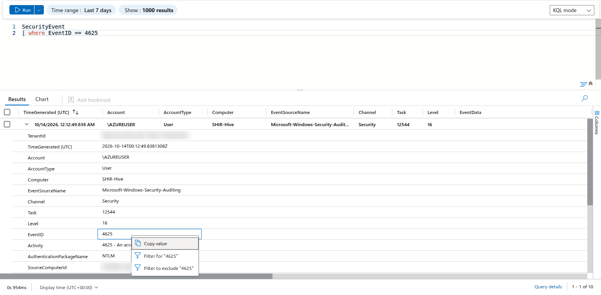
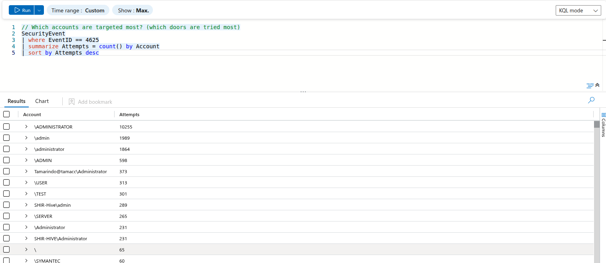
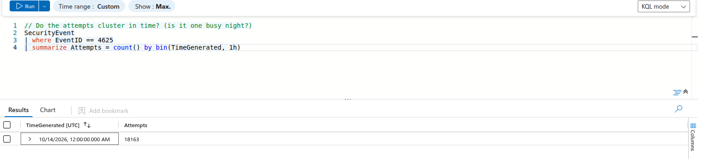

# Day 04 / 30 – Microsoft Sentinel & KQL Fundamentals

**MyDFIR 30-Day Microsoft Challenge** · Hands-on learning journal · Bo Mejdahl

📄 **[Download the full PDF journal](Day04_Sentinel_KQL_Hotel_Analogy.pdf)**


---

## The analogy I use for this whole day 🏨

I learn best with pictures in my head, so I treat Sentinel like a **big hotel**:

| Real thing | Hotel analogy |
|---|---|
| Log Analytics workspace | The hotel's **records room** where every logbook is stored |
| `SecurityEvent` table | The **reception logbook** – every badge swipe, check-in and door event gets a line |
| One row in the table | One **entry in the logbook** |
| Event ID 4625 | "**Wrong key card** – the door did not open" (a failed Windows logon) |
| A KQL query | **Instructions I give the night receptionist** about what to look up |
| The pipe symbol `\|` | "**...and then**" – each step works on what the previous step handed over |

Keeping this picture in mind made every operator below click for me.

---

## How a KQL query flows

```kql
SecurityEvent
| summarize EventCount = count() by EventID
| sort by EventCount desc
```

🏨 *"Open the reception logbook… **and then** make a tally of how many times each type of event happened… **and then** put the biggest tally on top."*

A high number alone does **not** mean something bad is happening – a busy hotel has lots of normal door swipes too. It tells me *where to look first*.

---

## Exercise 1 – Find failed Windows logons

```kql
SecurityEvent
| where EventID == 4625
```

🏨 **`where` = the receptionist's highlighter.** "Only show me the lines where someone used a wrong key card."

Event ID **4625** = failed logon. Causes can be innocent (typo in a password, an old saved password on a service) or suspicious (someone guessing passwords). This query is the starting point, not the verdict.



---

## Exercise 2 – Look at a sample first

```kql
SecurityEvent
| take 10
```

🏨 **`take` = flipping the logbook open and reading any 10 lines.** Good for learning what columns exist before writing a real query.

⚠️ `take` does **not** give the newest 10 – just *any* 10. For the latest events I need a sort (see below).


> 🔎 **What I noticed:** even in this small sample, the account names stand out: `admin`, `administrator` and `AZUREUSER`. These are classic guessable names, the kind an attacker tries first. In hotel terms: someone is trying the doors marked "Manager" and "Staff" rather than random guest rooms.

---

## Exercise 3 – Pick the useful columns and put them in order

```kql
SecurityEvent
| where EventID == 4625
| project TimeGenerated, TimeCollected, Account, Computer, EventID
| sort by TimeCollected asc
```

🏨 **`project` = photocopying only the columns I care about** (when, who, which door) instead of the whole page.
🏨 **`sort by … asc` = lining the entries up from oldest to newest**, like replaying the night in order.

💡 Lesson learned: `TimeCollected` exists in this training table, but not every environment has it. **Always check the column names in your own workspace** instead of assuming the tutorial matches.

> 📘 **Why my table names differ from the video:** in May 2026 Microsoft updated the Sentinel Training Lab and its sample data. The course video queries `SecurityEvent_CL` with a column `EventID_s`, while my workspace uses `SecurityEvent` and `EventID`. Same data idea, different labels. In hotel terms: the hotel printed new logbooks with renamed columns, so I read the headings before copying the old instructions.

---

## Exercise 4 – Count events by type

```kql
SecurityEvent
| summarize EventCount = count() by EventID
```

🏨 **`summarize count() by EventID` = the receptionist's tally sheet:** one line per event type, with the number of times it happened.

---

## Exercise 5 – Rank event types by frequency

```kql
SecurityEvent
| summarize EventCount = count() by EventID
| sort by EventCount desc
```

🏨 Same tally sheet, but **busiest event type on top**.


### What I saw in my results

- **4625 (failed logon) was the most common event by far – 18,163 entries**, compared with only 93 successful logons (4624). In hotel terms: a *lot* of wrong key cards. That is exactly the kind of pattern an analyst would dig into next.
- Some other IDs in the list and what they mean:

| Event ID | Meaning | Hotel analogy |
|---|---|---|
| 4624 | Successful logon | Key card worked, door opened |
| 4625 | Failed logon | Wrong key card |
| 4634 | Logoff | Guest left the room |
| 4672 | Special privileges assigned at logon | A **master key** was used |
| 4688 | New process created | Someone started using a room's equipment |
| 4798 / 4799 | Group membership was looked up | Someone checked **who is on the staff list** |

*(Note: I renamed the count column to `EventCount` for clarity – the course notes used `RandomCount`.)*

---

## Exercise 6 – Which accounts are targeted most?

```kql
SecurityEvent
| where EventID == 4625
| summarize Attempts = count() by Account
| sort by Attempts desc
```

🏨 **Counting wrong key cards per door.** Instead of "how many wrong key cards in total?", I ask the receptionist: "which doors were tried the most?"



| Account | Attempts | What it suggests |
|---|---|---|
| `\ADMINISTRATOR` | 10,255 | The built-in admin account: **56.5%** of all failed logons on its own |
| `\admin`, `\administrator`, `\ADMIN`, `\Administrator` | 1,989 / 1,864 / 598 / 231 | The same targets typed in different upper/lower case |
| `SHIR-Hive\admin`, `SHIR-HIVE\Administrator`, `Tamarindo@tamacc\Administrator` | 289 / 231 / 373 | Admin accounts with a computer or domain name in front |
| `\USER`, `\TEST`, `\SERVER`, `\SYMANTEC` | 313 / 301 / 265 / 60 | Generic default names, typical of an automated wordlist |

> 🔎 **What I found:** admin-style accounts add up to **15,830 of 18,163 failed logons (about 87%)**. The rest are generic names like USER, TEST and SERVER. This pattern is consistent with an **automated brute-force attempt** using a list of common default usernames, rather than a real employee mistyping a password.
>
> 🏨 In hotel terms: someone walked the corridor trying the **Manager's office** door over 10,000 times, then rattled the doors marked "Test", "Server" and "Staff". Guests who forgot their room number do not behave like that.

⚠️ KQL groups text **case-sensitively**, so `ADMINISTRATOR`, `administrator` and `Administrator` are counted as three different accounts. To see the true total per account, normalise the names first with `tolower()`.

---

## Exercise 7 – Do the attempts cluster in time?

```kql
SecurityEvent
| where EventID == 4625
| summarize Attempts = count() by bin(TimeGenerated, 1h)
```

🏨 **`bin(TimeGenerated, 1h)` sorts the logbook entries into one-hour buckets**, like asking: "how many wrong key cards between midnight and 1 am, between 1 and 2 am…?"



> 🔎 **What I found:** only **one row: all 18,163 failed logons in the same hour** (14 Oct 2026, 00:00 UTC). At first sight that looks like one massive attack burst. But this is a lesson about the data, not the attacker: in Exercise 2, every sample event had the **exact same timestamp** (12:12:49.838 AM). The training data was loaded into my workspace in one go, so `TimeGenerated` shows **when the logs arrived**, not when the logons were really attempted.
>
> 🏨 In hotel terms: an old logbook was photocopied into the new one at midnight. Every entry now carries the photocopy date, so it cannot tell me which night the doors were really tried.

**Why this matters for a SOC analyst:** in a real environment, a timeline is one of the strongest pieces of evidence. Before trusting it, I need to know which time field I am reading: the time the event happened, or the time it was collected.

---

## Key takeaways

1. KQL turns a giant logbook into a short, focused answer – one pipe step at a time.
2. `where` filters, `take` samples, `project` picks columns, `summarize` counts, `sort` orders, `bin()` groups by time.
3. About **87%** of the failed logons targeted admin-style accounts: a pattern consistent with automated brute force.
4. Text grouping is case-sensitive, so the same account can hide in several rows.
5. Check what a timestamp really means before building a timeline. Here it showed the data load, not the attack.
6. A big number is a **lead, not proof**. This is training data, not a confirmed attack.

## Next steps

The most important question is still open: **did any of these attempts succeed?** 🏨 After all those wrong key cards, did any door actually open?

```kql
// Did the targeted accounts ever log on successfully?
SecurityEvent
| where EventID in (4624, 4625)
| extend AccountLower = tolower(Account)
| where AccountLower has "admin"
| summarize Failed = countif(EventID == 4625),
            Succeeded = countif(EventID == 4624) by AccountLower
| sort by Failed desc
```

After that: find where the attempts come from (source IP address or workstation name, when those fields are available).

---

*Part of my MyDFIR 30-Day Microsoft Challenge – documenting each day with the query, its purpose, what I observed and what I learned.*
