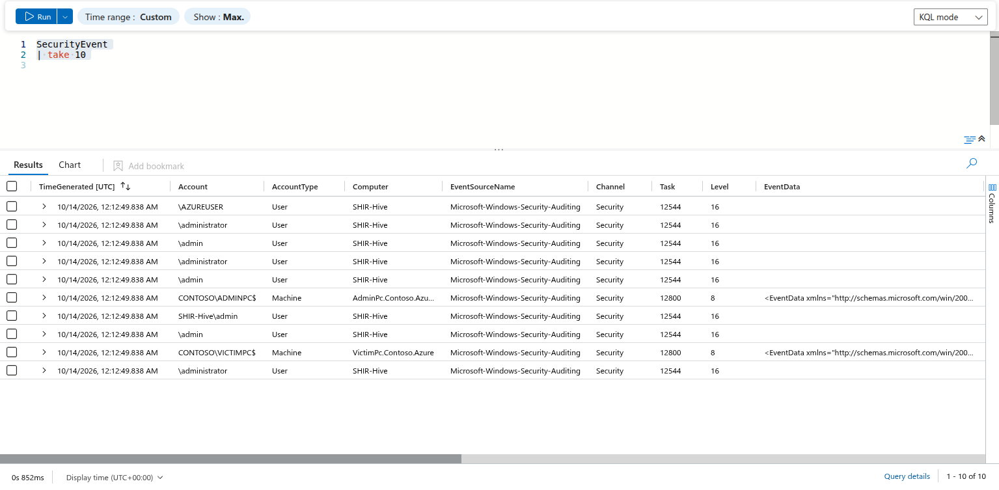
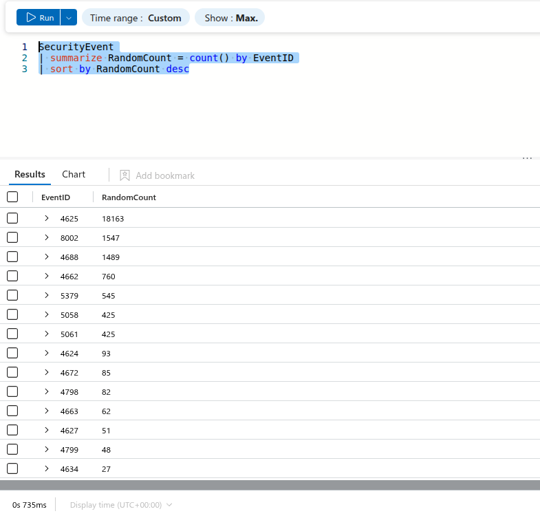

# Day 04 / 30 – Microsoft Sentinel & KQL Fundamentals

**MyDFIR 30-Day Microsoft Challenge** · Hands-on learning journal · Bo Mejdahl

Tools: Microsoft Sentinel · KQL · Windows Security Events

→ **[Download the full PDF journal](Day04_Sentinel_KQL_Hotel_Analogy.pdf)**

---

## Key findings

Investigating **18,163 failed Windows logons** (Event ID 4625) in Microsoft Sentinel:

1. **About 87% targeted admin-style accounts** (`ADMINISTRATOR` alone: 10,255), plus generic names like USER, TEST and SERVER. This pattern is consistent with an **automated brute-force attempt** using a list of common usernames.
2. **KQL groups text case-sensitively**, so `ADMINISTRATOR` and `administrator` show up as separate accounts.
3. **All attempts landed in one single hour**, but that is when I ingested the training data from a file, not when the logons happened. Exercise 8 proves it: check which clock a timestamp comes from before building a timeline.

---

## The analogy I use

I learn best with pictures in my head, so I treat Sentinel like a **hotel**:

| Real thing | Hotel analogy |
|---|---|
| Log Analytics workspace | The **records room** where every logbook is stored |
| `SecurityEvent` table | The **reception logbook**: every key-card swipe and door event gets a line |
| Event ID 4625 | A **wrong key card**: the door did not open (failed Windows logon) |
| A KQL query | **Instructions** I give the night receptionist |
| The pipe symbol `\|` | **"…and then"**: each step works on what the previous step handed over |

---

## Exercise 1 – Find failed logons

```kql
SecurityEvent
| where EventID == 4625
```

> Hotel: **`where` is the receptionist's highlighter:** "only show me the lines where someone used a wrong key card." A failed logon can be innocent (a typo) or suspicious (password guessing). This query is the starting point, not the verdict.


## Exercise 2 – Look at a sample first

```kql
SecurityEvent
| take 10
```

> Hotel: **`take` is flipping the logbook open and reading any 10 lines**, a quick way to see which columns exist. Note: it returns *any* 10 rows, not the newest.



> **Observation:** Even this small sample shows names like `admin`, `administrator` and `AZUREUSER`: someone trying the doors marked "Manager" and "Staff" rather than guest rooms.

## Exercise 3 – Pick columns and order them

```kql
SecurityEvent
| where EventID == 4625
| project TimeGenerated, TimeCollected, Account, Computer, EventID
| sort by TimeCollected asc
```

> Hotel: **`project` photocopies only the columns I need**, and **`sort by … asc`** replays the night from oldest to newest.

Note: the query runs, but `TimeCollected` turned out to hold no values in my dataset (see Exercise 8), so this sort does not really put anything in order. Lesson: check what a column actually contains, not just whether it exists.

> **Why my table names differ from the course video:** Microsoft updated the Sentinel Training Lab in May 2026. The video uses `SecurityEvent_CL` / `EventID_s`; my workspace uses `SecurityEvent` / `EventID`. Lesson: always check the column names in your own workspace.

## Exercise 4–5 – Count and rank events by type

```kql
SecurityEvent
| summarize EventCount = count() by EventID
| sort by EventCount desc
```

> Hotel: **`summarize count() by EventID` is the receptionist's tally sheet**, and `sort by … desc` puts the busiest event type on top.



| Event ID | Count | Meaning | Hotel analogy |
|---|---|---|---|
| 4625 | 18,163 | Failed logon | Wrong key card |
| 4688 | 1,489 | New process created | Equipment switched on in a room |
| 4624 | 93 | Successful logon | Key card worked |
| 4672 | 85 | Special privileges at logon | A **master key** was used |
| 4798 / 4799 | 82 / 48 | Group membership enumerated | Someone read the **staff list** |

Failed logons outnumber successful ones by almost 200 to 1, so that is where I dug in next.

## Exercise 6 – Which accounts are targeted most?

```kql
SecurityEvent
| where EventID == 4625
| summarize Attempts = count() by Account
| sort by Attempts desc
```

> Hotel: **Counting wrong key cards per door**: which doors were tried the most?


| Account | Attempts | What it suggests |
|---|---|---|
| `\ADMINISTRATOR` | 10,255 | Built-in admin account: 56.5% of all failed logons |
| `\admin`, `\administrator`, `\ADMIN`, `\Administrator` | 1,989 / 1,864 / 598 / 231 | Same targets, different upper/lower case |
| `SHIR-Hive\admin`, `SHIR-HIVE\Administrator`, `Tamarindo@tamacc\Administrator` | 289 / 231 / 373 | Admin accounts with a computer or domain prefix |
| `\USER`, `\TEST`, `\SERVER`, `\SYMANTEC` | 313 / 301 / 265 / 60 | Generic default names from a wordlist |

> Hotel: Someone tried the **Manager's office** door over 10,000 times, then rattled the doors marked "Test" and "Server". Guests who forgot their room number do not behave like that.

## Exercise 7 – Do the attempts cluster in time?

```kql
SecurityEvent
| where EventID == 4625
| summarize Attempts = count() by bin(TimeGenerated, 1h)
```

> Hotel: **`bin(TimeGenerated, 1h)` sorts the entries into one-hour buckets.**


Only **one row**: every event shares the same timestamp (also visible in Exercise 2), because I ingested the training data from a file, in one go. Exercise 8 proves it.

> Hotel: an old logbook was photocopied into a new one at midnight, so every entry carries the photocopy date, not the night the doors were really tried.

## Exercise 8 – Which clock can I trust?

```kql
SecurityEvent
| where EventID == 4625
| summarize Events = count(),
    FirstGenerated = min(TimeGenerated),
    LastGenerated  = max(TimeGenerated),
    FirstCollected = min(TimeCollected),
    LastCollected  = max(TimeCollected),
    FirstIngested  = min(ingestion_time()),
    LastIngested   = max(ingestion_time())
```

> Hotel: **checking the photocopier's own log.** Instead of trusting the time written on each line, I compare three clocks: when the line was written, when the guard collected it, and when it reached the records room.


| Clock | First | Last | Spread |
|---|---|---|---|
| `TimeGenerated` | 12:12:49.838 | 12:13:03.738 | about 14 seconds |
| Ingestion time | 12:13:02.083 | 12:15:23.629 | about 2½ minutes |
| `TimeCollected` | no values | no values | empty |

> **Observation:** all 18,163 failed logons were "generated" within **14 seconds** and reached the workspace within the next **2½ minutes**. This matches what I did: I ingested the training data from a file. `TimeGenerated` records the upload and `TimeCollected` is empty, so this dataset has **no trustworthy original event time**. I can still answer **who** was targeted and **how often**, but not **when** or **in what order**. Naming the limits of the evidence is part of the analysis.

---

## Skills practised

`where` (filter) · `take` (sample) · `project` (pick columns) · `summarize count()` (tally) · `sort by` (order) · `bin()` (group by time) · `ingestion_time()` (when data arrived). Plus two analyst habits: verify field names in your own environment, and treat a big number as a **lead, not proof**.

## Next step

The key open question: **did any door actually open?**

```kql
SecurityEvent
| where EventID in (4624, 4625)
| extend AccountLower = tolower(Account)
| where AccountLower has "admin"
| summarize Failed = countif(EventID == 4625),
            Succeeded = countif(EventID == 4624) by AccountLower
| sort by Failed desc
```

---

*Training data in a lab environment, not a confirmed attack. Part of my MyDFIR 30-Day Microsoft Challenge. Connect with me on [LinkedIn](https://www.linkedin.com/in/bomejdahl/).*
